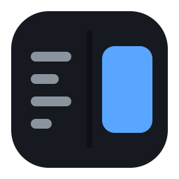

<div align="center">



# mmd-qt

**A fast, native, two-pane Markdown viewer and editor — plain Qt 6 Widgets, no web engine.**

[](LICENSE)
[](https://en.cppreference.com/w/cpp/20)
[](https://www.qt.io/)
[](https://cmake.org/)
[](#requirements)

</div>

---

`mmd-qt` opens instantly and re-renders as you type. It is one monolithic
desktop application built on Qt Widgets (`QPainter`, `QTextDocument`,
`QPlainTextEdit`) — **no Electron, no Qt WebEngine, no QML**. Markdown is
parsed by [md4c](https://github.com/mity/md4c) straight into a `QTextDocument`,
which keeps the binary small, the startup instant and the rendering fully
native.

```text
┌───────────────────────────────┬───────────────────────────────┐
│  Markdown source              │  Rendered preview             │
│  (syntax highlighted)         │  (CommonMark + GFM)           │
└───────────────────────────────┴───────────────────────────────┘
```

> Curious what it looks like? Open [`feature-showcase.md`](feature-showcase.md)
> — a single document that exercises every supported feature, with real image
> assets next to it.

<details>
<summary><strong>Table of contents</strong></summary>

- [Key features](#key-features)
- [Requirements](#requirements)
- [Getting started](#getting-started)
- [Packaging](#packaging)
- [Usage](#usage)
- [Architecture](#architecture)
- [Project layout](#project-layout)
- [Testing](#testing)
- [Documentation](#documentation)
- [Contributing](#contributing)
- [Acknowledgements](#acknowledgements)
- [License](#license)

</details>

## Key features

| | |
|---|---|
| **Two panes** | Editable source on the left, live preview on the right. Each pane can be hidden on its own. |
| **Live preview** | Edits render immediately; a burst of keystrokes is coalesced into one rebuild and the scroll position is kept. The two panes scroll in step. |
| **Reading width** | The preview column is capped and centred, so a wide window keeps a comfortable line length instead of stretching edge to edge. |
| **Typography** | Bundled [Inter](third_party/fonts/inter) for prose and [JetBrains Mono](third_party/fonts/jetbrains-mono) for code (both OFL), switchable to the system fonts. |
| **Code highlighting** | Fenced code blocks are highlighted per language by KDE's KSyntaxHighlighting, coloured from a theme-matched palette. Markdown itself is highlighted in the source pane. |
| **Images & animation** | Images resolve relative to the document; PNG, JPEG, WebP, **SVG** (rendered crisp and antialiased) and **animated GIF** all display. |
| **GFM** | Tables, task lists, strikethrough and autolinks. |
| **HTML inserts** | A tolerant subset of the HTML found in real READMEs — centred hero blocks, `<details>`/`<summary>`, tables, badges as offline chips, inline tags and `[!NOTE]` callouts. |
| **Copy code** | Hover a fenced block to reveal a copy button; one click puts its text on the clipboard. |
| **Themes** | Light, Dark, **Follow System** (reads the desktop's own colour scheme — e.g. a KDE Plasma scheme, as Dolphin does) and Custom. Themes are data: any theme loads from JSON, and discovered system schemes are listed in the menu. The choice is remembered across runs. |
| **Files** | Open, save, and follow external changes on disk — including the atomic-replace pattern most editors use. |
| **Sidebar** | A dockable panel with two tabs: a **table of contents** built from the headings, and a **file browser** for a whole folder of markdown. Hiding it is one keystroke. |
| **Outline** | Every heading, nested by level, generated from the rendered document rather than parsed a second time. Click one to jump there, and the section you are reading stays highlighted as you scroll. |
| **Find** | `Ctrl+F` opens a find strip over the pane that has the focus: literal search with wrap-around, a match counter, match-case toggle and every hit highlighted in place. |
| **Click to source** | Click anything in the preview and the editor's caret jumps to the line it came from — the Zed-style way to edit what you are reading. A drag still selects text, a link still follows, and the two panes scroll independently. |
| **LaTeX math** | `$e^{i\pi} + 1 = 0$` inline and `$$...$$` display formulas are typeset by the bundled [MicroTeX](third_party/microtex) engine and drawn as crisp, theme-coloured bitmaps. A formula that cannot be rendered shows its source text instead of a hole. |
| **Big documents** | The size policy keeps the window responsive: past 1 MB the preview updates when typing pauses, past 5 MB it waits behind a notice in the pane (with a "Render anyway" link) and the editor drops markdown highlighting. |

## Requirements

- A C++20 compiler — GCC 13+ or Clang 16+
- CMake ≥ 3.24 and Ninja
- **Qt 6.5+** — `Widgets`, `Test`, `Svg`
- **KDE Frameworks 6** — `KSyntaxHighlighting`

## Getting started

```sh
git clone git@github.com:TankucT-AC/mmd-qt.git
cd mmd-qt

cmake --preset gcc-debug
cmake --build --preset gcc-debug
ctest --preset gcc-debug

./out/gcc-debug/src/mmd                 # empty window
./out/gcc-debug/src/mmd feature-showcase.md
```

A release build with a second compiler is one more step:

```sh
cmake --preset clang-release
cmake --build --preset clang-release
ctest --preset clang-release
```

The presets write into `out/<preset>`; `.clangd` points at `out/gcc-debug`, so
the editor tooling finds the compilation database out of the box.

## Packaging

A minimal Debian package is built with CPack:

```sh
cmake --preset gcc-release
cmake --build --preset gcc-release
cd out/gcc-release && cpack -G DEB        # mmd-qt_<version>_amd64.deb
```

It installs the executable, the icon and `.desktop` entry, and — because KDE's
KSyntaxHighlighting is not packaged on every distribution (Ubuntu 24.04 LTS, for
one) — it also bundles that library **and** its syntax definitions. The package
therefore depends only on Qt 6.

> [!IMPORTANT]
> **Portability caveat.** The binary is built against *this* machine's Qt, so it
> runs only where Qt is at least as new (Ubuntu 24.04 LTS ships Qt 6.4 and is too
> old; 24.10+ / Debian 13 / Fedora / Arch are fine). For a friend on an older
> distribution, build the package on that distribution (or in a container of it),
> or use a Flatpak/AppImage that bundles Qt as well. Building from source with
> that distribution's own Qt is the other option.

## Usage

```sh
mmd                      # start empty
mmd notes.md             # open a file
mmd --preview notes.md   # open with the source pane hidden
```

| Shortcut | Action |
|:---------|:-------|
| `Ctrl+F` | Find in the focused pane |
| `F3` / `Shift+F3` | Next / previous match |
| `Esc` | Close the find strip |
| `Ctrl+B` | Show/hide the **sidebar** |
| `Ctrl+Shift+O` | Open a **folder** in the file browser |
| `F9` | Show/hide the **source** pane |
| `F10` | Show/hide the **preview** pane |
| `Ctrl+N` | New document |
| `Ctrl+O` | Open |
| `Ctrl+S` | Save |
| `Ctrl+Shift+S` | Save as |
| `Ctrl+Q` | Quit |

Themes live under **View → Theme**: *Follow System*, *Light*, *Dark*, *Custom*,
a list of **System Schemes** discovered on your desktop, and **Load Theme
File…** to open any theme from JSON. External edits to an open file are picked
up automatically; if you have unsaved changes you are asked before they are
replaced. The sidebar remembers the last folder you opened, and the **Outline**
tab follows the preview as you scroll.

## Architecture

The design is deliberately small: one internal static library (`mmd_core`) and
one executable, with dependencies pointing strictly one way.

```text
app/  ──▶  editor/  ──▶  core/        (MarkdownEditor, MarkdownHighlighter)
      ├──▶  viewer/  ──▶  core/        (MarkdownView, CodeHighlighter,
      │                                FindBar, GifObjectHandler,
      │                                CheckboxObjectHandler, ChipObjectHandler,
      │                                MathObjectHandler)
      └──▶  app panels ──▶ core/       (OutlinePanel, FileTreePanel, FindBar)

core/  MarkdownBuilder · Outline · FindState · DocumentLimits · MathRenderer ·
       Theme · ThemeManager · FontManager · FileDocument · ImageResolver ·
       SystemThemeProvider · HtmlFragment
```

- **`core`** includes nothing from the layers above it, so the renderer
  (`MarkdownBuilder`) is a pure function of `(source, style)` and is tested
  without a GUI. The same holds for the policies added later — `Outline`,
  `FindState`, `DocumentLimits` and `MathRenderer` are pure logic with their
  own unit tests.
- **Signals are the only glue** between layers; the wiring lives in
  `MainWindow` and in `FindController`, which is the one place that knows how
  the two find strips and the two panes fit together.
- Two rendering techniques cooperate: `MarkdownBuilder` turns markdown into a
  `QTextDocument`, and `CodeHighlighter` tints the fenced code blocks inside it.

See [`STYLEGUIDE.md`](STYLEGUIDE.md) for the full rationale.

## Project layout

```text
src/app/      MainWindow, sidebar panels, find controller
src/core/     markdown -> QTextDocument, outline, search, size policy,
              themes, fonts, files
src/editor/   the source pane: text editor + markdown highlighter
src/viewer/   the preview pane + code highlighting + find strip + animated images
tests/        one QTest binary per module, run through CTest
third_party/  vendored md4c (MIT), MicroTeX (MIT) + tinyxml2 (zlib),
              bundled fonts (OFL) and TeX font resources
src/doc/      reference documentation for the public classes
tools/        one-off generators, e.g. render-icons.cpp, which rebuilds
              resources/logo-*.png from resources/logo.svg
```

## Testing

Each module has one QTest binary, all registered with CTest:

```sh
ctest --preset gcc-debug                       # everything
./out/gcc-debug/tests/test_markdown -functions # one binary
```

Pure logic (the renderer, themes, fonts, file watching) is asserted directly;
widgets are driven head-less with `QT_QPA_PLATFORM=offscreen`, and the composed
window is exercised end to end in `test_app`. Painted output is verified by
rendering into an image and inspecting pixels where it matters (code-block
continuity, SVG anti-aliasing).

## Documentation

| Document | Contents |
|---|---|
| [`STYLEGUIDE.md`](STYLEGUIDE.md) | Architecture, conventions and the change pipeline |
| [`TUTORIAL.md`](TUTORIAL.md) | QPainter fundamentals kept from the project's origins |
| [`src/doc/`](src/doc/index.md) | Per-class reference documentation |
| [`CONTRIBUTING.md`](CONTRIBUTING.md) | Process, and the **licensing rules** you must follow |
| [`feature-showcase.md`](feature-showcase.md) | A document exercising every feature |

## Contributing

Contributions are welcome. Before you start, please read
[`CONTRIBUTING.md`](CONTRIBUTING.md) — in particular the **licensing rules**
(never remove license notices; no AI co-authorship; commits are the
contributor's responsibility) and the architecture constraints (QWidgets only,
monolithic, one-way dependencies). The short version: write a failing test
first, keep commits small and conventional, format with `clang-format`, and
verify with both compilers.

## Acknowledgements

`mmd-qt` stands on the work of others:

| Project | Role | License |
|---|---|---|
| [Qt](https://www.qt.io/) | Application framework | LGPL-3.0 / commercial |
| [KSyntaxHighlighting](https://github.com/KDE/syntax-highlighting) | Fenced-code highlighting | MIT |
| [md4c](https://github.com/mity/md4c) | Markdown parser (vendored) | MIT |
| [Inter](https://github.com/rsms/inter) | Prose typeface (bundled) | SIL OFL 1.1 |
| [JetBrains Mono](https://github.com/JetBrains/JetBrainsMono) | Code typeface (bundled) | SIL OFL 1.1 |

## License

Released under the **GNU General Public License v3.0 or later** — see
[`LICENSE`](LICENSE). Bundled third-party components keep their own licenses;
the full list is in [`CONTRIBUTING.md`](CONTRIBUTING.md#licensing-rules-mandatory).