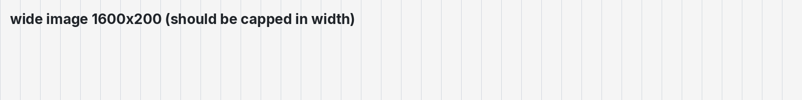

# mmd-qt feature showcase

A single document that exercises every markdown feature the viewer renders:
typography, lists, quotes, code, tables, links, images and animated pictures.

> **How to use it:** open this file in mmd-qt and scroll. Anything that looks
> wrong here is a rendering bug worth reporting.

---

## 1. Typography

mmd-qt renders prose in **Inter** and code in **JetBrains Mono**. Headings follow
a modular scale, so each level is proportionally smaller than the one above it.

# Heading level 1
## Heading level 2
### Heading level 3
#### Heading level 4
##### Heading level 5
###### Heading level 6

Body text is regular. **Bold text** stands out, *italic text* leans, and
***bold italic*** does both. ~~Struck-through text~~ is crossed out, and inline
code like `MarkdownBuilder::build()` uses the monospace font on a tinted
background.

A hard line break ends here,  
and the next line starts right below it (two trailing spaces).

Entities decode: `&amp;` → &amp;, `&copy;` → &copy;, `&mdash;` → &mdash;,
`&hellip;` → &hellip;, `&rarr;` → &rarr;.

## 2. Lists

Unordered:

- First item
- Second item with **emphasis**
- Third item with `code`

Ordered:

1. Step one
2. Step two
3. Step three

Nested (mixed):

- Parent
  - Child A
  - Child B
    1. Grandchild one
    2. Grandchild two
- Parent again

Task list:

- [x] Render markdown to a `QTextDocument`
- [x] Highlight fenced code blocks
- [ ] Add a theme editor
- [ ] Support footnotes

## 3. Block quotes

> A plain quote.
>
> With a second paragraph inside it.
>
> > And a nested quote.
> >
> > - it can hold lists
> > - and `code`
>
> Back to the outer level.

## 4. Code

Inline: use `QTextDocument::setMarkdown` when you do not need control.

Fenced, C++:

```cpp
// Demp the needle towards the target each frame.
const float dt = std::clamp(m_frameTimer.restart() / 1000.0f, 0.0f, 0.1f);
const float k = 1.0f - std::exp(-dt / 0.15f);
m_shown += (m_target - m_shown) * k;
```

Fenced, Python:

```python
def damped(target: float, shown: float, dt: float, tau: float = 0.15) -> float:
    k = 1.0 - math.exp(-dt / tau)
    return shown + (target - shown) * k
```

Fenced, with blank lines and a long line (the box must stay one rectangle and
the long line must wrap *inside* it):

```bash
cmake --preset gcc-debug && cmake --build --preset gcc-debug && ctest --preset gcc-debug

clang-format -i <files>

cmake --preset clang-release && cmake --build --preset clang-release && ctest --preset clang-release
```

Fenced, JSON:

```json
{
  "name": "mmd-qt",
  "qt": "6.12.0",
  "features": ["live preview", "syntax highlighting", "themes"]
}
```

Fenced, YAML:

```yaml
theme:
  mode: system
  fallback: dark
render:
  interval_ms: 40
  preserve_scroll: true
```

Indented code block (four spaces):

    this is an indented code block
    it renders without a language

## 5. Tables

| Feature            | Status | Notes                          |
|:-------------------|:------:|-------------------------------:|
| Live preview       |  done  | coalesced re-render            |
| Code highlighting  |  done  | KSyntaxHighlighting            |
| Animated GIF       |  done  | played in place                |
| Footnotes          |  todo  | not enabled in v1              |

Right-aligned numbers:

| Metric   |  Value |
|:---------|-------:|
| Files    |     27 |
| Tests    |      9 |
| Warnings |      0 |

## 6. Links

Inline link: [Qt documentation](https://doc.qt.io/qt-6/).

Autolink: https://github.com/mity/md4c

Reference link: [CommonMark spec][spec].

Relative link: [the styleguide](../STYLEGUIDE.md) and [contributing](../CONTRIBUTING.md).

[spec]: https://spec.commonmark.org/

## 7. Images

Static PNG (relative path):


JPEG:


SVG (vector):


WebP:


Animated GIF (should play in place):


A very wide image (should be scaled down to fit the pane):



A missing image (placeholder is expected):


## 8. Video

Markdown has **no native video element**, so there is nothing standard to embed.
mmd-qt shows raw HTML as literal text, so this tag stays visible as source:

<video src="assets/clip.mp4" poster="assets/photo.jpg" controls></video>

For moving pictures, use an **animated GIF** — it plays in the preview. A poster
image plus a link is the other common pattern:


[sample clip (mp4)](assets/clip.mp4)

---

## 9. Escapes and special characters

Literal asterisks: \*not emphasis\*, literal underscores: \_not emphasis\_,
literal backticks: \`not code\`.

A backslash at the end of a line does a hard break:\
like this.

---

## 10. Checklist

- [x] Headings and the type scale
- [x] Emphasis, strikethrough, inline code
- [x] Lists, nested lists, task lists
- [x] Block quotes, including nested
- [x] Fenced code in several languages, with blank lines
- [x] Tables with alignment
- [x] Links: inline, autolink, reference, relative
- [x] Images: PNG, JPEG, SVG, WebP, GIF, wide, missing
- [x] Horizontal rules
- [ ] Whatever you find missing — add it here